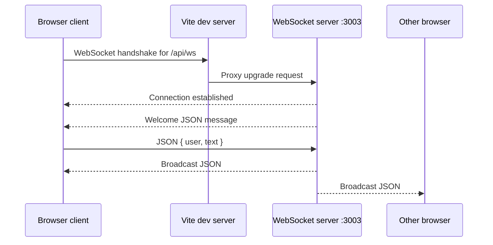

# WebSocket Chat Flow

## Big Picture

The chat uses a persistent, two-way WebSocket connection. A browser sends a message to the server; the server broadcasts it to every connected client, including the sender. The sender displays the broadcast just like everyone else.

The browser connects to Vite, not directly to the chat server. Vite proxies `/api/ws` to the WebSocket server on port `3003`. That proxy configuration joins the two pieces in [vite.config.ts](../client/vite.config.ts#L13).



## Connection Setup

When you click **Connect Socket**, the client builds a URL using the page's current host and chooses `ws:` or `wss:` to match the page's protocol. It opens a browser `WebSocket` for `/api/ws`: [main.ts](../client/src/main.ts#L119).

The server creates a WebSocket server attached to its HTTP server, restricted to that same path, and listens on port `3003`: [server.ts](../servers/ws-chat/src/server.ts#L5). The HTTP server is created from Express, but this chat server does not define any Express routes; WebSocket handling is done by the `ws` library.

At the protocol level, the browser starts with an HTTP request asking to upgrade the connection to WebSocket. Vite forwards that upgrade because its `/api/ws` proxy has `ws: true`. Once the upgrade succeeds, the connection stays open for messages in either direction; it is not a series of separate `fetch` requests.

The browser's `open` event fires once that connection is ready. The client enables the chat controls, clears the chat display, and adds a local "channel opened" line. The server separately sends a welcome message when it accepts the connection, which arrives through the client's `message` handler. These are two distinct lines: one generated locally by the client and one sent by the server.

## Sending And Broadcasting

Submitting the chat form trims the input and checks two things: the message is nonempty, and the socket exists and is `OPEN`. It then sends this JSON shape:

```json
{ "user": "GuestUser", "text": "Hello" }
```

That is the application's message format; WebSocket transports data but does not define what `user` or `text` mean. The client serializes the object with `JSON.stringify` and sends it as a WebSocket message: [main.ts](../client/src/main.ts#L159).

On the server, the `message` handler converts the incoming frame to text, parses the JSON, and creates a new JSON object containing only `user` and `text`: [server.ts](../servers/ws-chat/src/server.ts#L24). It iterates through `wss.clients` and sends that payload to every client whose connection is open: [server.ts](../servers/ws-chat/src/server.ts#L37).

That includes the sender. The client does **not** add its own chat message immediately after `socket.send`; it waits for the server's broadcast to return. Each client handles the incoming message, parses the JSON, and appends it to the chat display: [main.ts](../client/src/main.ts#L138).

The browser safely inserts the message text using `textContent`, rather than interpreting it as HTML. The username is placed in a `<strong>` element, while the message body goes into a `<span>`.

## Disconnect And Errors

Clicking **Disconnect** calls `socket.close()`. When the connection closes, the client's `close` handler re-enables Connect, disables the chat controls, adds a local "channel closed" line, and clears its socket reference: [main.ts](../client/src/main.ts#L143). The server also listens for `close`, but only logs that the client disconnected: [server.ts](../servers/ws-chat/src/server.ts#L50).

Malformed JSON is caught on the server and logged; it is not broadcast. The client's `error` handler only logs to the browser console. There is no automatic reconnect, connection-status indicator for errors, message history, or server-side username verification.

## Important Boundaries

- The username is supplied by the browser, so it is a display label, not an authenticated identity.
- There are no rooms: every connected client receives every valid message.
- The server has no schema validation beyond parsing JSON. A valid JSON value with missing or unexpected fields can still reach the broadcast logic.
- The nearby WebRTC example also uses a WebSocket, but for signaling on a different connection and port. Its chat data eventually travels over a WebRTC data channel; that is separate from this broadcast chat.

## Following The Flow In A Debugger

Place breakpoints at the client's `socket.send`, the server's `ws.on("message")`, the server's `client.send`, and the client's `socket.onmessage`. That shows one submitted message making the complete round trip.
